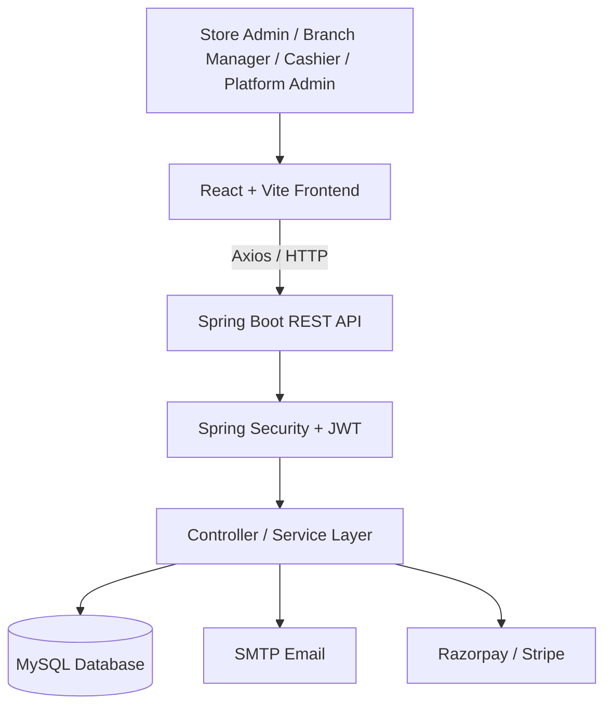

<div align="center">

# POS System POS

### A modern, multi-role Point of Sale & retail operations platform

Manage stores, branches, products, inventory, employees, orders, payments, and subscriptions through one full-stack application.

<br/>

[](https://pos-system-saas.vercel.app/)
[](https://react.dev/)
[](https://spring.io/projects/spring-boot)
[](https://www.java.com/)
[](https://www.mysql.com/)

<br/>

**[Live Demo](https://pos-system-saas.vercel.app/)** · **[Features](#what-the-platform-covers)** · **[Architecture](#architecture)** · **[Run Locally](#run-locally)** · **[Security](#security-and-deployment-checklist)**

</div>

---

## ✨ About the project

**POS System POS** is a full-stack point-of-sale and retail management application. It is organized as two independently runnable applications:

- **Frontend:** React single-page application built with Vite. It provides role-oriented interfaces, client-side routing, state management, and API communication.
- **Backend:** Java 17 and Spring Boot REST API. It provides business endpoints, authentication and authorization, persistence through Spring Data JPA, and integrations for email and payment providers.
- **Database:** MySQL.

The product structure supports store-level administration, branch operations, cashier workflows, and platform administration. The exact workflows available in a running deployment depend on the backend URL, database, provider configuration, and deployed version.

<details>
<summary><strong>Project snapshot</strong></summary>

| Area | Implementation |
|---|---|
| Frontend | React 19 + Vite 7 |
| Backend | Java 17 + Spring Boot 3.5.3 |
| Persistence | Spring Data JPA / Hibernate |
| Database | MySQL 8 |
| Authentication | Spring Security + JWT |
| Password encoding | BCrypt |
| Payments | Razorpay SDK and Stripe SDK dependencies |
| Email | Spring Boot Mail / SMTP |
| Frontend state | Redux Toolkit |
| Frontend API client | Axios |
| Package/build tools | pnpm and Maven Wrapper |
| Frontend hosting | Vercel deployment |

</details>

## 🚀 Live application

<div align="center">

### Try the deployed frontend

[](https://pos-system-saas.vercel.app/)

[https://pos-system-saas.vercel.app/](https://pos-system-saas.vercel.app/)

</div>

> **Deployment note:** The supplied source snapshot has `VITE_API_BASE_URL=YOUR_BACKEND_URL` in `pos-frontend/.env.production`. Configure the real backend API URL in the Vercel project's environment variables and redeploy. A working frontend URL does not by itself confirm that the backend, database, email, or payment integrations are live.

## What the platform covers

The following areas are represented by the frontend routes/pages and backend controller modules in the supplied source.

### Store operations

- Store dashboard and store-level analytics
- Store profile and settings
- Branch management
- Product and category management
- Inventory visibility
- Employee management
- Customer management
- Orders, refunds, and reports

### Branch operations

- Branch-level dashboard and analytics
- Branch management
- Inventory and product workflows
- Employees and customers
- Orders and refund workflows
- Shift-related reporting

### Cashier / point of sale

- Cashier-facing application routes
- Product and customer workflows
- Order and payment endpoints
- Refund-related workflows
- Shift report endpoints

### Platform administration

- Administrative dashboard endpoints
- Subscription management
- Subscription plan management
- Store and branch administration

### Authentication and security

- Authentication endpoints
- JWT request validation
- Spring Security filter chain
- BCrypt password encoder configuration
- Role-aware API authorization rules

> Feature presence in source code should not be interpreted as a guarantee that every workflow is fully implemented, tested, or enabled in the deployed environment.

## Architecture



### Request flow

1. A user interacts with the React application.
2. The frontend API client sends HTTP requests to the configured backend base URL.
3. The backend security filter chain processes requests and validates JWT authentication.
4. Controllers delegate business operations to the backend service/repository layers.
5. Spring Data JPA persists application data in MySQL.
6. Email and payment integrations are handled by backend services when configured.

## 🧰 Technology stack

| Layer | Tools and libraries |
|---|---|
| UI framework | [React 19](https://react.dev/) |
| Frontend tooling | [Vite 7](https://vite.dev/) |
| Styling and UI primitives | Tailwind CSS 4, Radix UI, Lucide React |
| Routing | React Router |
| State management | [Redux Toolkit](https://redux-toolkit.js.org/) / React Redux |
| HTTP client | [Axios](https://axios-http.com/) |
| Form handling | Formik, React Hook Form |
| Validation | Yup, Zod |
| Backend language | [Java 17](https://www.java.com/) |
| Backend framework | [Spring Boot 3.5.3](https://spring.io/projects/spring-boot) |
| API | Spring Web |
| Authentication | Spring Security, JJWT |
| Password hashing | BCrypt |
| ORM / persistence | Spring Data JPA, Hibernate |
| Database driver | MySQL Connector/J |
| Payment SDKs | Razorpay Java SDK, Stripe Java SDK |
| Email | Spring Boot Mail |
| Frontend package manager | pnpm |
| Backend build | Maven Wrapper |

Useful official references:
[Spring Security](https://docs.spring.io/spring-security/reference/) ·
[Spring Data JPA](https://spring.io/projects/spring-data-jpa) ·
[MySQL](https://dev.mysql.com/doc/) ·
[Maven](https://maven.apache.org/guides/) ·
[Razorpay](https://razorpay.com/docs/) ·
[Stripe](https://docs.stripe.com/)

## 📁 Repository structure

```text
pos-system-saas/
├── README.md
├── .gitignore
│
├── pos-frontend/
│   ├── public/
│   ├── src/
│   │   ├── assets/
│   │   ├── components/
│   │   ├── context/
│   │   ├── hooks/
│   │   ├── lib/
│   │   ├── pages/
│   │   ├── Redux Toolkit/
│   │   ├── routes/
│   │   ├── utils/
│   │   ├── App.jsx
│   │   └── main.jsx
│   ├── package.json
│   ├── pnpm-lock.yaml
│   ├── vite.config.js
│   └── vercel.json
│
└── pos-backend/
    ├── src/
    │   ├── main/
    │   │   ├── java/com/POS System/
    │   │   │   ├── configrations/
    │   │   │   ├── controller/
    │   │   │   ├── domain/
    │   │   │   ├── exception/
    │   │   │   ├── mapper/
    │   │   │   ├── modal/
    │   │   │   ├── payload/
    │   │   │   ├── repository/
    │   │   │   ├── service/
    │   │   │   └── util/
    │   │   └── resources/
    │   └── test/
    ├── .mvn/
    ├── mvnw
    ├── mvnw.cmd
    ├── Dockerfile
    └── pom.xml
```

### Backend API modules

The backend source contains these controller modules:

| Domain | Controller |
|---|---|
| Authentication | `AuthController` |
| Users | `UserController` |
| Stores | `StoreController` |
| Branches | `BranchController` |
| Products | `ProductController` |
| Categories | `CategoryController` |
| Inventory | `InventoryController` |
| Customers | `CustomerController` |
| Employees | `EmployeeController` |
| Orders | `OrderController` |
| Refunds | `RefundController` |
| Payments | `PaymentController` |
| Shift reports | `ShiftReportController` |
| Subscriptions | `SubscriptionController` |
| Subscription plans | `SubscriptionPlanController` |
| Store analytics | `StoreAnalyticsController` |
| Branch analytics | `BranchAnalyticsController` |
| Admin dashboard | `AdminDashboardController` |

## Run locally

### Prerequisites

Install:

- Java 17
- MySQL 8
- Node.js LTS
- pnpm
- Git

Check your local versions:

```bash
java -version
node --version
pnpm --version
mysql --version
```

### 1. Clone the repository

```bash
git clone https://github.com/<your-github-username>/pos-system-saas.git
cd pos-system-saas
```

Replace `<your-github-username>` with the GitHub account that owns the repository.

### 2. Create a MySQL database

Start MySQL and create a database:

```sql
CREATE DATABASE pos_db;
```

The backend's database configuration reads these environment variables:

```bash
export DB_URL="jdbc:mysql://localhost:3306/pos_db"
export DB_USERNAME="your_mysql_username"
export DB_PASSWORD="your_mysql_password"
```

### 3. Configure backend environment

The backend `application.yml` reads the database, mail, and frontend reset URL from environment variables.

```bash
export MAIL_USERNAME="your_email_address"
export MAIL_PASSWORD="your_email_app_password"
export FRONTEND_RESET_URL="http://localhost:5173/auth/reset-password?token="
export PORT="8080"
```

**Additional backend configuration is required before using payment or production authentication:**

- `razorpay.api.key`, `razorpay.api.secret`, and `stripe.api.key` are currently placeholder values in `application.yml`. Replace them with backend-only environment-backed configuration before enabling payment processing.
- `JwtConstant.java` currently uses a placeholder signing key (`YOUR_OWN_KEY`). Replace hard-coded key handling with a strong secret loaded securely by the backend. The JWT provider and validator must use the same key.
- `SecurityConfig.java` contains a placeholder CORS origin (`YOUR_OWN_FRONTEND_URL_LIST`). Configure the exact frontend origin, such as `https://pos-system-saas.vercel.app`.
- `PaymentServiceImpl.java` contains local callback/redirect URLs. Configure production callback URLs before using live payment flows.
- `spring.jpa.hibernate.ddl-auto` is currently `create`. Do not point this setting at a database containing data you need. Use a controlled schema migration approach for production.

### 4. Start the backend

Open a terminal:

```bash
cd pos-backend
chmod +x mvnw
./mvnw spring-boot:run
```

The backend defaults to port `8080` (or the configured `PORT` value).

To build and test:

```bash
./mvnw clean test
./mvnw clean package
```

### 5. Configure the frontend

The frontend API client reads:

```js
import.meta.env.VITE_API_BASE_URL
```

Create `pos-frontend/.env.local`:

```env
VITE_API_BASE_URL=http://localhost:8080
```

Then start the frontend:

```bash
cd pos-frontend
pnpm install
pnpm dev
```

Vite normally serves the development application at `http://localhost:5173`.

Available scripts from `package.json`:

```bash
pnpm dev
pnpm build
pnpm preview
pnpm lint
```

### 6. Configure the Vercel deployment

In the Vercel project:

1. Open **Settings → Environment Variables**.
2. Add `VITE_API_BASE_URL`.
3. Set it to the deployed backend API base URL.
4. Apply it to the required deployment environments.
5. Redeploy the frontend.

[Official Vercel environment-variable documentation](https://vercel.com/docs/environment-variables)

> Variables prefixed with `VITE_` are bundled into browser-accessible frontend code. Never store database passwords, JWT signing keys, SMTP app passwords, Stripe secret keys, or Razorpay secret keys in `VITE_` variables.

## Security and deployment checklist

This checklist is based on inspection of the supplied source archive. It does not prove the current contents of your GitHub history or deployed environment.

### Critical: revoke the exposed Gmail App Password

The original `pos-backend/src/main/resources/application.yml` contained a Gmail App Password in a **commented-out configuration block**. Commenting out a credential does not make it safe to publish.

1. Revoke that App Password in [Google Account App Passwords](https://myaccount.google.com/apppasswords).
2. Remove the obsolete commented configuration block from `application.yml`.
3. Keep only environment-variable references for mail credentials.
4. If the credential was pushed to GitHub, deleting it in a later commit does not remove it from older commits. Review GitHub's [sensitive-data removal guidance](https://docs.github.com/en/authentication/keeping-your-account-and-data-secure/removing-sensitive-data-from-a-repository).

Do not copy the exposed value into issues, commits, screenshots, or chat messages.

### Other findings from the source review

| File | Finding | Recommended action |
|---|---|---|
| `pos-backend/src/main/java/com/POS System/configrations/JwtConstant.java` | Placeholder JWT signing key is hard-coded | Load a strong secret from backend environment/secret configuration; share the same key between signing and validation |
| `pos-backend/src/main/resources/application.yml` | Razorpay and Stripe values are placeholders | Use backend-only environment-backed configuration |
| `pos-backend/src/main/resources/application.yml` | `ddl-auto: create` | Use migrations and a safe production schema strategy |
| `pos-backend/src/main/resources/docker-compose.yml` | Local MySQL root credentials are `root` / `root` | Use local-only credentials; use a restricted DB account and secrets for shared/production environments |
| `pos-backend/src/main/java/com/POS System/configrations/SecurityConfig.java` | CORS origin is a placeholder | Configure the exact frontend origin |
| `pos-backend/src/main/java/com/POS System/configrations/SecurityConfig.java` | Broad `/api/**` authorization matcher appears before `/api/super-admin/**` | Review matcher order; specific authorization rules should be evaluated before broad matching rules |
| `pos-backend/src/main/java/com/POS System/service/impl/PaymentServiceImpl.java` | Localhost payment callback/redirect URLs | Move URLs to backend configuration |
| `pos-frontend/.env.production` | API URL is `YOUR_BACKEND_URL` | Set `VITE_API_BASE_URL` in Vercel and redeploy |
| `pos-frontend/src/utils/uploadToCloudinary.js` | Cloud name and unsigned upload preset are browser-visible | Restrict unsigned uploads by file type, size, and preset permissions; never expose a Cloudinary API secret |

### Remove stray SSH-key-named files

The supplied archive included these oddly named files in `pos-frontend/`:

```text
Enter passphrase (empty for no passphrase):
Enter passphrase (empty for no passphrase):.pub
```

The private-key-named file contained placeholder text rather than a usable OpenSSH private key. They are not application files and should be removed:

```bash
rm -f "pos-frontend/Enter passphrase (empty for no passphrase):"
rm -f "pos-frontend/Enter passphrase (empty for no passphrase):.pub"
```

### Before making the repository public

- [ ] Revoke the exposed Gmail App Password.
- [ ] Confirm no real `.env` files or provider secrets are tracked.
- [ ] Replace placeholder JWT configuration with secure backend configuration.
- [ ] Configure the production CORS origin.
- [ ] Configure the backend API URL in Vercel.
- [ ] Replace payment placeholders and local callback URLs before live payments.
- [ ] Replace `ddl-auto: create` before using persistent production data.
- [ ] Review authorization rules and test every role.
- [ ] Check the repository's previous commits for exposed secrets.
- [ ] Enable GitHub secret scanning and push protection if available for the repository.

## 🛣️ Possible next improvements

- Add API documentation with OpenAPI / Swagger.
- Add integration tests for authentication, inventory, orders, refunds, and payments.
- Add database migrations with Flyway or Liquibase.
- Add CI checks for frontend lint/build and backend tests.
- Add Docker-based local development with safe environment-variable configuration.
- Add structured logging, health checks, monitoring, and backup/restore documentation.
- Add deployment documentation for the backend API and database.

## 📄 License

No license file was present in the supplied project archive. Until a license is added, do not assume that others have permission to reuse, modify, or redistribute this code.

Learn more: [Choose an open-source license](https://choosealicense.com/).

---

<div align="center">

### POS System POS

**Simplifying point-of-sale and retail operations.**

[](https://pos-system-saas.vercel.app/)

Built with React · Spring Boot · MySQL

</div>
